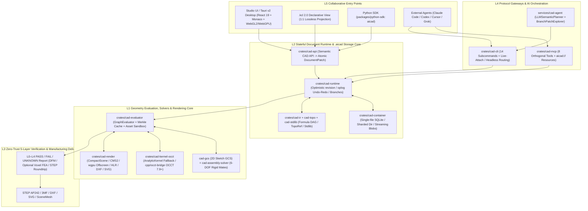

# Architecture & Capability Matrix

**English** | [简体中文](../zh/architecture.md) | [Docs Index](../README.md)

AI-Native CAD uses a five-layer architecture anchored on **local-first execution, a single source of truth, a single structured mutation gate, dynamic kernel isolation, and zero-trust tri-state verification**. It serves interactive 3D modeling, declarative `.kcl` authoring, Python generative scripts, and external/built-in AI agents through the exact same runtime.

---

## 1. Five-Layer System Architecture

---

## 2. Six Architectural Invariants

1. **Single Source of Truth (SSOT)**: Every model's canonical state lives in the `.aicad` container's strongly typed `CanonicalGraph`. Shared material presets live exclusively in `schemas/materials.json`, and cross-language constants are generated from `schemas/contracts-ssot.json`.
2. **Single Structured Mutation Gate**: UI controls, Feature Dashboard actions, `.kcl` edits, Python SDK calls, built-in `cad-agent`, and external MCP clients all submit statically checked `SemanticCommand` / `DocumentPatch` transactions to `cad-runtime`, sharing one SQLite `oplog` history and optimistic `revision` lock.
3. **Kernel-Agnostic Persistent Topology**: Face and edge identities (`LineageTopoRef` evolution + geometric fingerprints and `QueryTopoRef` semantic selectors) are owned by `crates/cad-topo` independently of OCCT's internal `TNaming`, keeping the B-Rep backend pluggable.
4. **Dynamic OCCT Isolation & License Hygiene**: Core Rust, TypeScript, and Python code is Apache-2.0. OpenCASCADE (LGPL-2.1) stays isolated behind the dynamic C ABI bridge (`cpp/occt-bridge`) or out-of-process service (`cpp/cad-geometry-engine`), with zero GPL modules in core runtimes.
5. **Zero-Trust Tri-State Verification (`PASS / FAIL / UNKNOWN`)**: Unrun checks or non-authoritative fallback kernels must report `UNKNOWN` rather than silently succeeding. Rendered PNGs and visual checks are advisory and never issue a standalone `PASS`.
6. **Strict Workspace Layering**: All 26 Rust crates adhere to a directed L0–L5 dependency hierarchy; `cad-ir` and `cad-render` stay decoupled from persistence containers.

---

## 3. Rust Workspace Layer Map (26 Crates)

| Layer | Crates | Role |
| :---: | :--- | :--- |
| **Layer 0 (Leaf Foundations)** | `cad-syntax`, `cad-topo`, `cad-stdlib`, `cad-gcs`, `cad-mesh-io`, `cad-observe`, `cad-cadpack`, `cad-slicer`, `cad-subd`, `cad-assembly-solver` | Zero internal-crate dependencies: parser, topology naming, engineering stdlib, 2D/3D solvers, mesh IO, streaming pack, experimental geometry |
| **Layer 1 (IR, Container & Kernel)** | `cad-ir`, `cad-hir`, `cad-container`, `cad-api`, `cad-kcl-bridge`, `cad-kernel-occt`, `cad-implicit`, `cad-gpu-compute`, `cad-lsp`, `cad-scene-mesh` | Canonical Graph IR, dimensional checker, `.aicad` container, Semantic API, `.kcl 2.0` bridge, dual-mode kernel, LSP, scene DTOs |
| **Layer 2 (Evaluation & Rendering)** | `cad-evaluator`, `cad-render` | Unified `GraphEvaluator`, Merkle cache, asset sandbox, `CompactScene`/`CMS2`, `wgpu` offscreen rendering, DXF/SVG/HLR |
| **Layer 3 (Runtime & Decompiler)** | `cad-runtime`, `cad-decompiler` | Stateful session runtime, preview branches, L3 DFM/Voxel FEA verification, and B-Rep feature recognition |
| **Layer 4 (Protocol Gateway)** | `cad-mcp` | 8 orthogonal MCP tools, `aicad://` progressive resources, stdio & loopback Streamable HTTP gateway |
| **Layer 5 (CLI Binary)** | `cad-cli` | Unified headless CLI, daemon, and live-attach proxy across 14 subcommands |

---

## 4. Honest Implementation Status Matrix

> **Legend**: `Implemented` = working in the default build; `Optional Native` = requires feature flags and native runtime libraries; `Experimental` = compiling crate present in the workspace outside the default mechanical-part UI workflow.

| Subsystem | Status | Notes |
| :--- | :---: | :--- |
| **`.aicad` Container & `CanonicalGraph` Pipeline** (`cad-ir`, `cad-container`, `cad-kcl-bridge`, `cad-api`, `cad-runtime`) | Implemented | Single-file SQLite (`oplog`, branches, streaming `blobs`, `node_brep_cache`), directory & sharded directory containers, live `Formula DAG`, structured 2D sketches, `.kcl 2.0` projection |
| **Dual-Mode B-Rep Kernel & Mesh IO** (`cad-kernel-occt`, `cad-mesh-io`, `cpp/occt-bridge`) | Implemented / Optional Native | Default pure-Rust `AnalyticKernel` + STL/3MF/OBJ/glTF parser; `--features occt-ffi` enables native OCCT 7.9+ B-Rep, STEP/IGES/BREP, hybrid booleans, direct hole edits, and exact HLR |
| **Solvers & Engineering Stdlib** (`cad-gcs`, `cad-assembly-solver`, `cad-stdlib`) | Implemented | 2D homotopy-continuation sketch solver with SVD DOF diagnostics, 6-DOF rigid mate solver, metric fastener/bearing/ISO 286/materials catalog |
| **Studio Workbench & Desktop Host** (`apps/studio-ui`, `apps/desktop`) | Implemented | NX/Creo layout, Feature Dashboard, WebGL2/WebGPU viewport, section/explode views, 2D drawings, Live-Attach IPC, native desktop exports |
| **MCP Gateway, Python SDK & Built-in Agent** (`cad-mcp`, `packages/python-sdk`, `services/cad-agent`) | Implemented | 8 tools + `aicad://` resources (stdio / HTTP / Live-Attach), `aicad` SDK, V2 `SemanticAgent`, Best-of-N branch exploration |
| **Offscreen Rendering & GPU Compute** (`cad-render`, `cad-gpu-compute`) | Optional / Experimental | `--features wgpu-renderer` renders shaded multi-view PNGs and semantic face masks; `cad-gpu-compute` (WGSL LBVH interference, ray-beam DFM, voxel FEA) and WASM viewport continue evolving |
| **Implicit SDF / SubD / Slicer / Decompiler** (`cad-implicit`, `cad-subd`, `cad-slicer`, `cad-decompiler`, `cpp/cad-geometry-engine`) | Experimental | Modular crates evolving independently while the main workbench focuses on parametric mechanical parts and rigid assemblies |

See [THIRD_PARTY_NOTICES.md](../../THIRD_PARTY_NOTICES.md) for license compliance boundaries.
