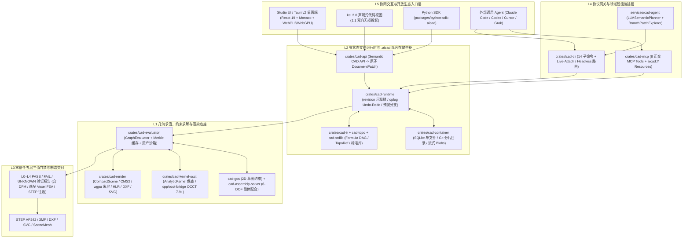

# 系统架构与能力矩阵

[English](../en/architecture.md) | **简体中文** | [文档索引](../README.md)

AI-Native CAD 采用 **“本地优先、唯一真相源、唯一写入口、内核动态隔离、零信任三值门禁”** 的五层全栈架构，同时支撑人类工程师的 3D 交互建模、声明式代码编辑、Python 科学生成以及内外多模态 AI Agent 协同。

---

## 1. 五层全栈架构总览

---

## 2. 六大核心架构不变量

1. **单一文档与常量真源（SSOT）**：所有模型真相统一归口至 `.aicad` 承载的强类型 `CanonicalGraph`；跨 Rust/TypeScript/Python 共享的材料目录以 `schemas/materials.json` 为唯一来源，共享协议常量以 `schemas/contracts-ssot.json` 自动代码生成。
2. **唯一结构化写边界**：UI 手柄与 Feature Dashboard、`.kcl` 视图编辑、Python SDK、内置 `cad-agent` 与外部 MCP 工具全部收敛为强类型 `SemanticCommand` / `DocumentPatch` 写入 `cad-runtime`，共享同一套 SQLite `oplog` Undo/Redo 与乐观锁 `revision`。
3. **内核无关的双轨持久化拓扑命名**：面/边身份由 `crates/cad-topo` 独立掌控（`LineageTopoRef` 演化血缘与几何指纹 + `QueryTopoRef` 语义谓词），不绑定 OCCT 内部 `TNaming`，确保可插拔替换商业或开源几何内核。
4. **OCCT 动态库隔离与开源合规**：核心 Rust/TS/Python 采用 Apache-2.0；OCCT（LGPL-2.1）严格通过 `cpp/occt-bridge` C ABI 动态库或独立几何进程（`cpp/cad-geometry-engine`）隔离，无 GPL 污染。
5. **零信任三值工程门禁（`PASS / FAIL / UNKNOWN`）**：未执行检查或非权威回退内核必须诚实输出 `UNKNOWN`，严禁静默视为 `PASS`；多视角渲染图仅作辅助审阅证据，不单独签发 `PASS`。
6. **严格的 Crate 分层边界**：Rust 工作区 26 个 crate 按 L0–L5 单向分层（由仓内卫生门禁持续校验），禁止下层反向依赖上层，禁止 `cad-ir` / `cad-render` 依赖持久化容器。

---

## 3. 工作区 26 个 Rust Crate 分层图

| 架构层级 | Crate 列表 | 职责定位 |
| :---: | :--- | :--- |
| **Layer 0（纯底层基础）** | `cad-syntax`, `cad-topo`, `cad-stdlib`, `cad-gcs`, `cad-mesh-io`, `cad-observe`, `cad-cadpack`, `cad-slicer`, `cad-subd`, `cad-assembly-solver` | 无内部 crate 依赖的词法语法、拓扑命名、标准件库、2D/3D 求解器、离散网格 IO、流式包与实验性几何模块 |
| **Layer 1（IR、容器与内核）** | `cad-ir`, `cad-hir`, `cad-container`, `cad-api`, `cad-kcl-bridge`, `cad-kernel-occt`, `cad-implicit`, `cad-gpu-compute`, `cad-lsp`, `cad-scene-mesh` | Canonical Graph IR、量纲类型检查、`.aicad` 容器、Semantic API、`.kcl 2.0` 双向桥、双模内核、LSP 与场景 DTO |
| **Layer 2（求值与渲染）** | `cad-evaluator`, `cad-render` | 统一 `GraphEvaluator`、节点 Merkle 缓存、资产沙箱、`CompactScene`/`CMS2`、`wgpu` 离屏渲染与 DXF/SVG/HLR |
| **Layer 3（运行时与反编译）** | `cad-runtime`, `cad-decompiler` | 双栖有状态文档会话、分支沙箱、L3 DFM/Voxel FEA 验证与 B-Rep 特征识别反编译 |
| **Layer 4（协议网关）** | `cad-mcp` | 8 大正交 MCP Tools、`aicad://` 渐进式资源、stdio / 本地 Streamable HTTP 网关 |
| **Layer 5（可执行入口）** | `cad-cli` | 14 个子命令的统一无头 CLI 与守护/代理入口 |

---

## 4. 真实实现状态矩阵（以当前仓库代码为准）

> **状态说明**：`已实现` = 源码与默认链路可运行；`可选原生` = 需启用特性开关及对应动态库；`实验性` = 仓库含可编译原型 crate，当前位于默认机械零件主航道之外。

| 子系统 | 当前状态 | 说明 |
| :--- | :---: | :--- |
| **`.aicad` 容器与 `CanonicalGraph` 管线**（`cad-ir` / `cad-container` / `cad-kcl-bridge` / `cad-api` / `cad-runtime`） | 已实现 | SQLite 单文件工作态（`oplog`/分支/流式 `blobs`/`node_brep_cache`）、目录与分片目录、实时量纲 `Formula DAG`、结构化 2D 草图与 `.kcl 2.0` 投影 |
| **双模 B-Rep 内核与网格 IO**（`cad-kernel-occt` / `cad-mesh-io` / `cpp/occt-bridge`） | 已实现 / 可选原生 | 默认纯 Rust `AnalyticKernel` + STL/3MF/OBJ/glTF 解析；`--features occt-ffi` 启用真实 OCCT 7.9+ B-Rep、STEP/IGES/BREP、混合布尔、通孔直编与精确 HLR |
| **约束与标准库**（`cad-gcs` / `cad-assembly-solver` / `cad-stdlib`） | 已实现 | 2D 同伦防翻转草图约束求解（含 SVD DOF 诊断）、6-DOF 刚体配合求解、公制紧固件/轴承/ISO 286/材料查表库 |
| **Studio 工作台与桌面宿主**（`apps/studio-ui` / `apps/desktop`） | 已实现 | NX/Creo 风格布局、Feature Dashboard、WebGL2/WebGPU 视口、剖切/爆炸图、2D 工程图、Live-Attach IPC 与本地原生导出 |
| **MCP 网关、Python SDK 与内置 Agent**（`cad-mcp` / `packages/python-sdk` / `services/cad-agent`） | 已实现 | 8 工具 + `aicad://` 资源（stdio / HTTP / Live-Attach）、`aicad` SDK、V2 `SemanticAgent` 与 Best-of-N 分支探索 |
| **离屏渲染与 GPU 算子**（`cad-render` / `cad-gpu-compute`） | 已实现（可选） / 实验性 | `--features wgpu-renderer` 支持离屏多视角 PNG 与像素语义掩码；`cad-gpu-compute`（WGSL LBVH 干涉/射线束 DFM/体素 FEA）与 `cad-render` WASM 持续演进中 |
| **隐式 SDF / SubD / 切片 / 逆向反编译**（`cad-implicit` / `cad-subd` / `cad-slicer` / `cad-decompiler` / `cpp/cad-geometry-engine`） | 实验性 | 作为独立可插拔模块在仓库内演进，当前默认工作台主界面聚焦参数化机械零件与刚体装配 |

详细许可与第三方合规边界见 [THIRD_PARTY_NOTICES.md](../../THIRD_PARTY_NOTICES.md)。
